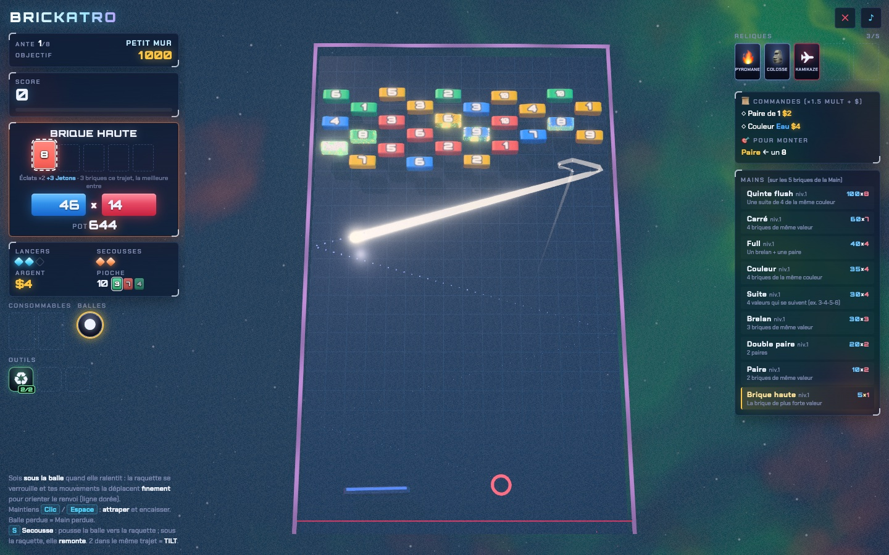
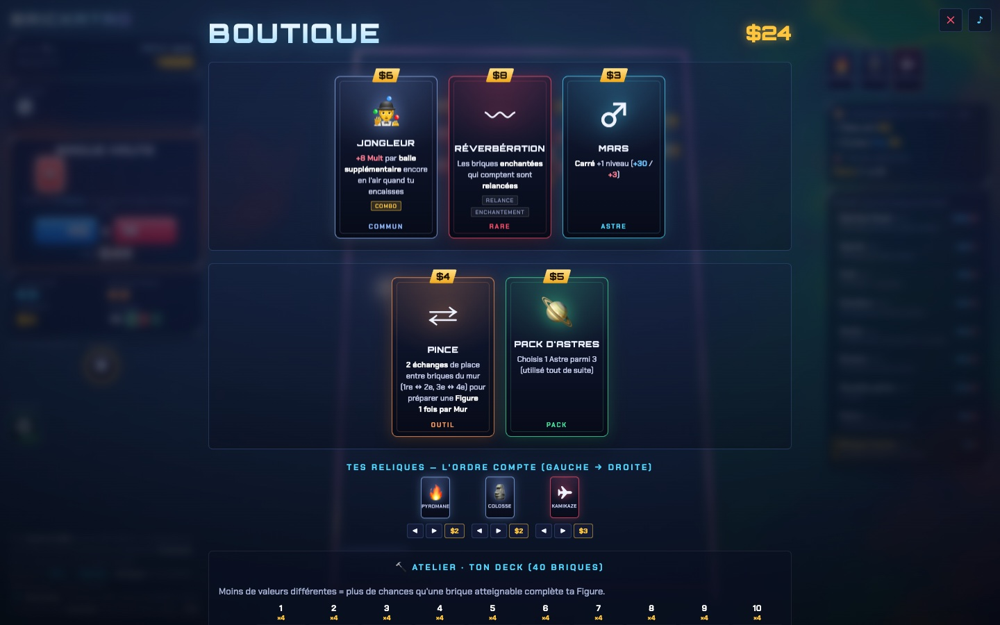

# Brickatro

Casse-briques roguelike inspiré de Balatro : chaque brique est une carte (couleur et valeur de 1 à 10), et les briques cassées forment une main de poker qui rapporte des points. Le jeu tourne dans le navigateur, sur ordinateur et sur mobile.

**Jouer en ligne : [drschizzo.github.io/brickatro](https://drschizzo.github.io/brickatro/)**



## Principe

- **Le mur et le deck.** Les briques du mur sont tirées d'un deck de 40 cartes (4 couleurs × valeurs 1 à 10) que l'on fait évoluer pendant la partie.
- **La Main.** À chaque renvoi de la balle sur la raquette, la meilleure brique cassée pendant le trajet entre dans la Main (5 briques au plus). Les autres briques cassées sont des Éclats, qui ajoutent des Jetons.
- **Les Figures.** La Main est évaluée comme une main de poker : Paire, Brelan, Suite, Couleur, Full, Carré, Quinte flush. Le score vaut Jetons × Mult.
- **Encaisser.** Maintenir le bouton attrape la balle et encaisse la Main. Si la balle est perdue, la Main l'est aussi. Chaque renvoi supplémentaire fait monter un multiplicateur de Série : continuer rapporte plus, mais risque tout.
- **Les Murs et les Antes.** Chaque Ante compte trois Murs (Petit, Grand, Boss) avec un objectif de score et un nombre de Lancers limité. Les Boss imposent une contrainte (raquette réduite, couleur éteinte, contrôles inversés…). La partie est gagnée après l'Ante 8 ; un mode Infini prend ensuite le relais.
- **La boutique.** Entre deux Murs : Reliques (effets permanents qui se combinent), Runes (modifient des briques du deck), Astres (améliorent une Figure), balles spéciales, Outils et Atelier (retirer ou retailler des briques du deck).



## Commandes

| Action | Souris / clavier | Tactile |
|---|---|---|
| Déplacer la raquette | Souris, ← → | Glisser |
| Viser puis lancer | Maintenir puis relâcher Clic / Espace | Maintenir puis relâcher le bouton |
| Attraper la balle et encaisser | Maintenir Clic / Espace | Maintenir le bouton |
| Secousse (pousser ou sauver la balle) | S | Bouton Secousse |
| Défausse (remplacer des briques du mur) | R | Carte ♻ |
| Choisir une balle spéciale | 1 à 6 | Toucher la balle |
| Couper le son | M | Bouton ♪ |
| Quitter la partie | Échap | Bouton ✕ |

Un tutoriel animé est disponible depuis le menu. La partie est sauvegardée au début de chaque Mur et peut être reprise avec « Continuer ».

## Lancer le projet

Prérequis : Node.js 20 ou plus récent.

```bash
npm install
npm run dev
```

| Script | Rôle |
|---|---|
| `npm run dev` | Serveur de développement (Vite) |
| `npm run build` | Vérification des types puis build de production dans `dist/` |
| `npm run preview` | Sert le build de production |
| `npm test` | Tests (Vitest) |
| `npm run typecheck` | Vérification des types du jeu, des tests et du banc |
| `npm run bench` | Banc de simulation : des bots jouent des parties complètes (voir [bench/README.md](bench/README.md)) |

Paramètres d'URL : `?classic` joue avec le jeu de règles d'origine, `?q=low|medium|high` force la qualité graphique.

## Architecture

Le projet est écrit en TypeScript, avec Three.js pour le rendu 3D et une interface en DOM.

```
src/
  rules/    Règles et contenu, sans dépendance au rendu : briques, Figures, scoring, Reliques, Boss, boutique, jeu de règles
  sim/      Physique du casse-briques (balle, raquette, collisions, prédiction de trajectoire)
  engine/   Moteur d'une partie : Engine orchestre les Murs et les Lancers, avec ses services
            Hand (Main et scoring), WallDeck (pioche et pose du mur), Consumables, Shop
  app/      Présentation : scène 3D (View), effets visuels et sonores, affichage de la Main,
            visée, ciblage des briques, écran de boutique
  render/   Rendus Three.js (briques, balles, particules, post-traitement)
  ui/       HUD et écrans en DOM
  audio/    Sons et musique générés
  meta/     Profil du joueur et sauvegarde de la partie
  game.ts   Enchaînement des phases de jeu, relie entrées, moteur et présentation
bench/      Banc de simulation (bots qui jouent avec le vrai moteur)
tests/      Tests unitaires et parties de référence
```

Quelques principes :

- **Les règles ne dépendent pas du rendu.** `Engine` et `World` tournent sans navigateur ; le jeu et le banc de simulation utilisent exactement le même moteur.
- **Le contenu porte son comportement.** Une Relique ou une amélioration de brique décrit son effet dans sa propre définition (`src/rules/relics.ts`, `src/rules/bricks.ts`) via des points d'accroche (`onBrickBroken`, `onRebound`, `score`…) et l'interface `EffectApi`. Ajouter du contenu ne demande pas de modifier le moteur.
- **Un jeu de règles explicite.** Les variantes de règles sont regroupées dans un objet immuable (`src/rules/ruleset.ts`) attaché à la partie.
- **Déterminisme.** Le hasard d'une partie vient d'un générateur à graine (`src/core/rng.ts`) : une même graine rejoue la même partie, ce qui permet la sauvegarde et les tests de référence.

## Tests

`npm test` lance les tests unitaires (Figures, scoring, effets, sauvegarde) et des parties complètes jouées par le bot du banc avec des graines fixes, dont le résultat est comparé à une référence enregistrée. Après une modification volontaire des règles, la référence se met à jour avec `npx vitest run -u`.

La physique étant chaotique, un écart infime dans les calculs flottants suffit à changer une partie : la référence est enregistrée sur macOS ARM (Apple Silicon) et ces tests ne passent que sur cette architecture. La CI les exécute sur un runner macOS.

## Déploiement

Chaque push sur `main` lance le workflow [`.github/workflows/deploy.yml`](.github/workflows/deploy.yml) : tests (sur macOS), build, puis publication sur GitHub Pages.
